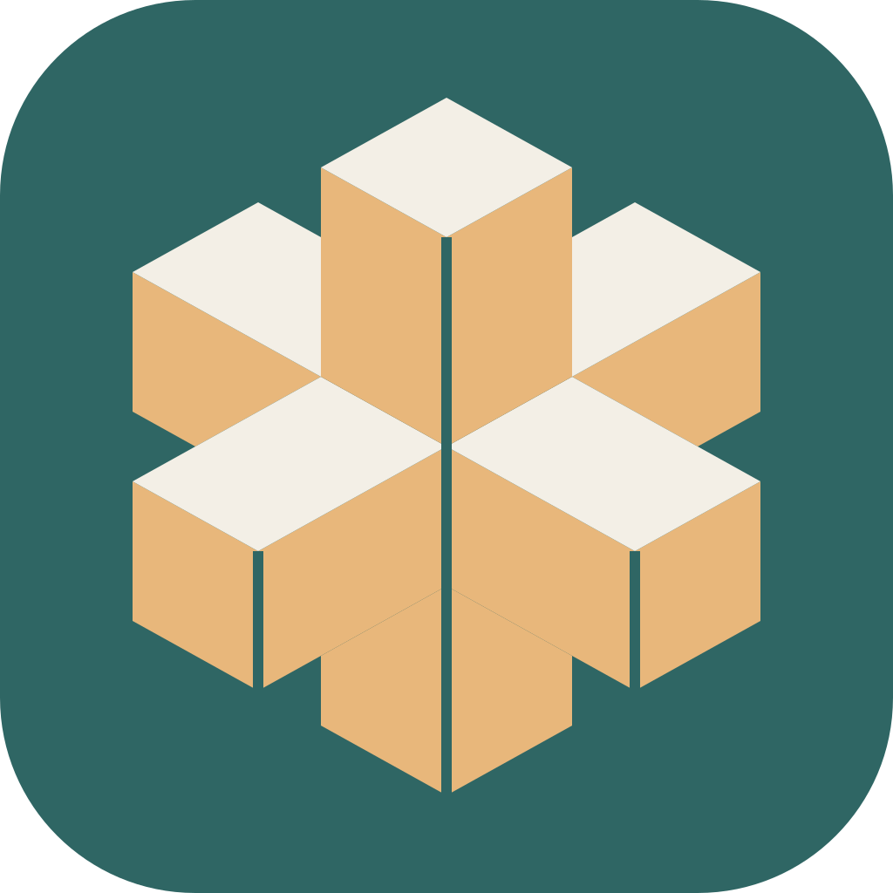
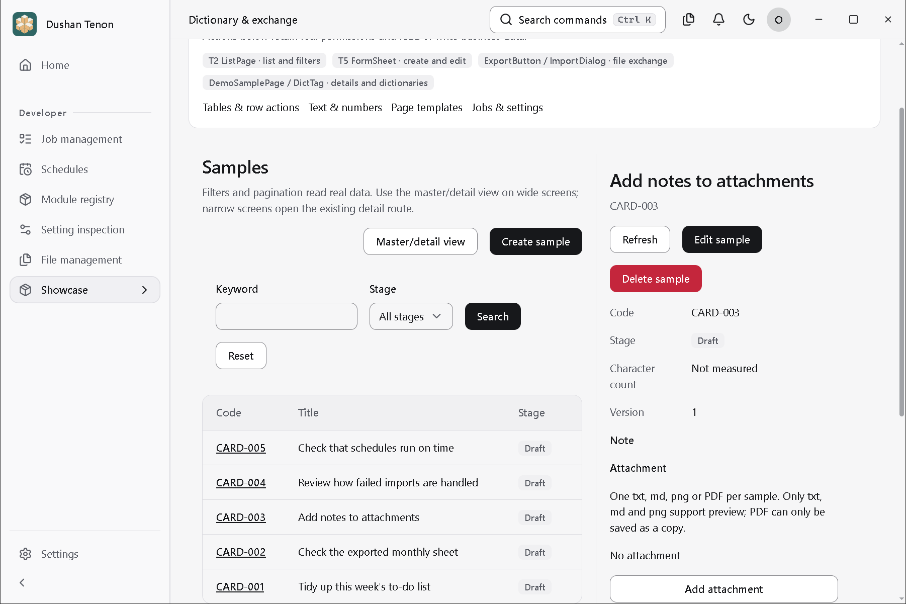
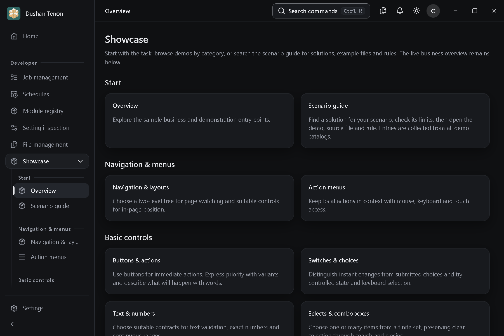
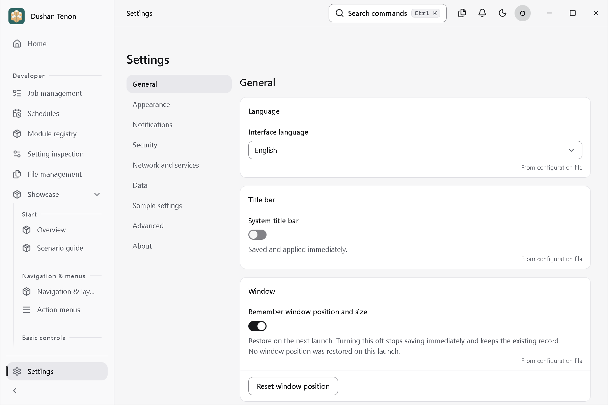
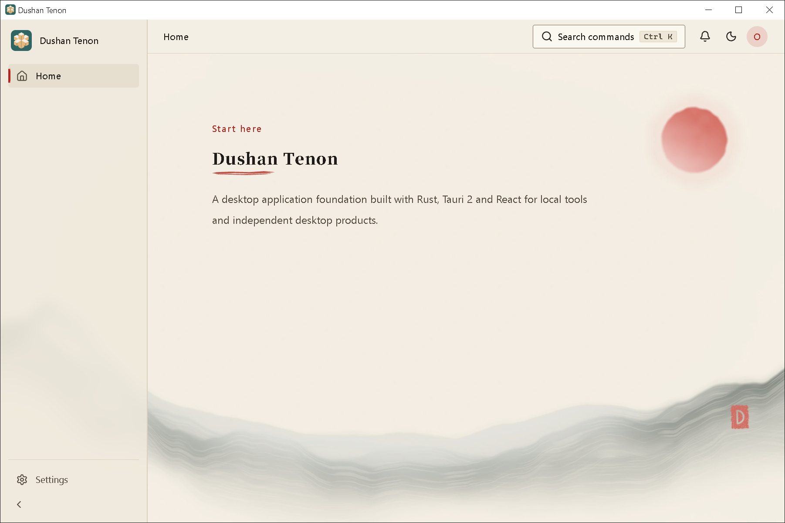
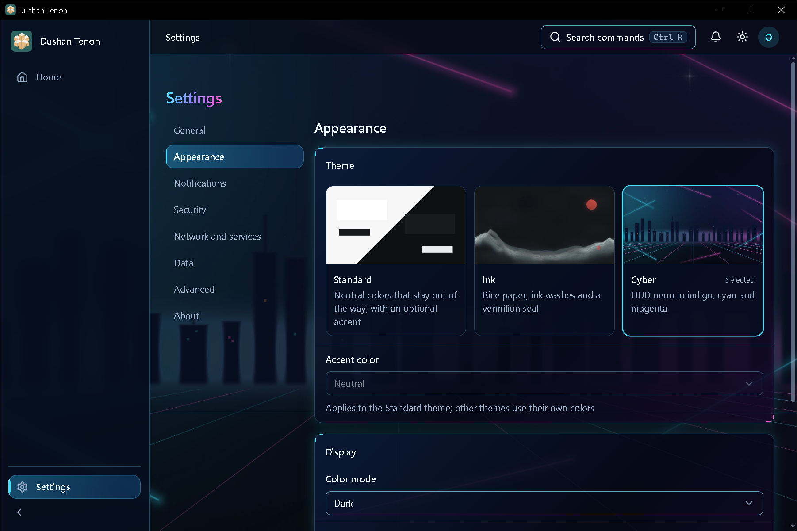

<p align="center">
  
</p>

<h1 align="center">Dushan Tenon</h1>

<p align="center">An assemblable foundation for single-user desktop tools · Rust + Tauri 2 + React / TypeScript</p>

<p align="center"><a href="README.md">中文</a> | English</p>

When you build a small desktop tool, the business logic itself often takes little time. What eats the time is everything around it: sign-in and locking, a settings page, notifications, the tray, data storage and backup. Every new tool means writing that ring again.

Dushan Tenon turns that ring into a foundation. You can think of it as "an empty desktop app with the surroundings already in place": you add your own business modules on top, and modules you don't need can be switched off in the configuration or removed from the code.



*Main window (light): the Showcase "Dictionary & exchange" page. The five samples were created by hand in a fresh state directory as demo data.*

> **Status:** v0.1.0, the first stable release. Interfaces and configuration may still change before 1.0. Developed and tested on Windows 10 / 11 only.

## 1. What it is

- A Windows desktop application foundation written in Rust + Tauri 2 + React / TypeScript, for local tools and independent desktop products.
- Built for a single user: one owner per computer. It can run without sign-in, or with an owner account sign-in and an app lock.
- Assembled from modules: business features live in modules, which the host assembles explicitly. There are five modules today; every one except account can be switched off.
- The layering rules are written in the [architecture document](docs/architecture.md) (Chinese) and checked automatically by `pnpm check`, so the structure holds up as the code grows.

## 2. Who it is for, and who it is not for

It is a foundation for developers, not finished software that works out of the box.

**A good fit for:**

- developers who want to build Windows desktop tools with Rust + Tauri + React without starting from sign-in, settings and the tray;
- tools used by one person on one computer;
- people willing to follow the project's layering rules and check their code with `pnpm check`.

**Not a good fit for:**

- users who want to download and use it without changing any code;
- multi-user systems, team collaboration, or anything that needs a server;
- projects that need to run on macOS or Linux in production.

## 3. What it can do today

### Five modules

| Module | What it does | Can be switched off |
|---|---|---|
| account | Sole owner, no sign-in or sign-in, sessions and app lock | No, every other module depends on it |
| notify | In-app notifications, desktop notifications, job completion alerts | Yes |
| files | List, preview, save copies of local files, and the reclaim entry | Yes |
| devtools | View, cancel, retry and manually resolve background jobs; check schedules | Yes |
| demo | Sample data, attachments, import and export, measurement, and the Showcase | Yes |

The diagnostic pages (Job management, Schedules, Module registry, Setting inspection, File management) and the Showcase are hidden by default. They appear after you turn on "Developer mode" under "Settings → Advanced".



*The Showcase overview in dark mode: demo pages for components, page templates and business samples, grouped by category.*

### What the foundation provides

These do not belong to any module; the foundation provides them directly: a settings center (General, Appearance, Network and services, Data, Advanced, About, and modules can add their own sections), a command palette (Ctrl K), the tray and a prompt when closing the window (hide to the tray or quit), launch at login (installed builds), a global shortcut to show the main window, remembered window position and size, a single instance (launching again brings back the existing window), an HTTP proxy, a database (SQLite by default, MySQL or PostgreSQL also supported), a cache (local or Redis), background jobs and schedules, full backup and restore (with SQLite and the local cache), redacted diagnostic export, auto-update (installed builds, from GitHub Releases), plus Chinese and English interfaces and light, dark and follow-system color modes.



*The General section of Settings. Each item shows where its value comes from in the lower right, such as "From configuration file".*

### Three themes

Standard, Ink and Cyber, each with a light and a dark set. Ink and Cyber have a background picture and a slow ambient animation. Switch themes in Settings > Appearance, where you can also pick an accent color for the Standard theme, choose comfortable or compact density, and turn motion off. To write or add a theme, see the [frontend guide](docs/frontend.md#视觉子系统与主题) (in Chinese); later releases will add more themes.



*The Ink theme, light.*



*The Cyber theme, dark: choosing a theme in Settings > Appearance.*

### Three presets

A preset is the configuration seed for a new state directory. It decides which modules are on and whether sign-in is required:

| Preset | Enabled modules | Sign-in | Title bar |
|---|---|---|---|
| minimal | account | None | System title bar |
| tool | account, notify | None | System title bar |
| full | All five | Required | Drawn by the app |

All three presets turn on the tray, ask whether to hide to the tray or quit when you close the window, and do not launch at login. See [section 4](#switch-to-a-preset) for how to apply one.

## 4. Run it locally

### Just want a look

Download `dushan-tenon-<version>-x64-setup.exe` from [Releases](https://github.com/dushanaicode/dushan-tenon/releases/latest). It installs for the current user and does not need administrator rights.

- The installer is not code-signed, so Windows SmartScreen may say "Windows protected your PC". Choose "More info > Run anyway". You can check the file against `SHA256SUMS.txt` on the same page first.
- The installed app checks for updates in Settings > About. You can also turn on "Check for updates after startup" in Settings > General (off by default, so nothing goes online at startup).

To change the code and build your own tool, run it from source:

### Requirements

- Windows 10 / 11 with the WebView2 runtime (built into Windows 11; on Windows 10 it is usually installed by system updates)
- Microsoft C++ Build Tools ("Desktop development with C++" in Visual Studio Build Tools); see the [Tauri prerequisites](https://v2.tauri.app/start/prerequisites/)
- Node.js 24 and pnpm 11.16.0 (`package.json` pins this version)
- Rust stable 1.98 or later

### First launch

From the repository root, run:

```powershell
pnpm install
pnpm dev
```

In PowerShell, use `pnpm.cmd`, for example `pnpm.cmd dev`. The first run compiles every Rust dependency, so it takes a while.

**What success looks like:** a Dushan Tenon window opens without asking you to sign in, and the home page shows "Start here". The diagnostic pages and the Showcase are hidden by default; turn on "Developer mode" under "Settings → Advanced" to see them.

**Where the data lives:** `pnpm dev` always uses `Temp/dev-state` in the repository, which holds the configuration, database and logs. Delete that directory and the next launch starts fresh.

**If something goes wrong:**

- A message says port 17430 is in use: close the program holding it (often a `pnpm dev` that did not exit last time) and run it again;
- The window does not appear or startup fails: read the logs in `Temp/dev-state/logs`.

### Switch to a preset

```powershell
pnpm preset full
pnpm dev
```

`pnpm preset` writes the preset to `Temp/dev-state/config.toml` and refuses to overwrite an existing file. To switch presets, delete that file, or the whole `Temp/dev-state`, first. The full preset requires sign-in, so the first launch asks you to set the owner password.

### Common commands

| Command | What it does |
|---|---|
| `pnpm dev` | Start the development window |
| `pnpm check` | Run every check: layering and naming, product identity, IPC contracts, UI kit rules, release configuration, dependency licenses, plus Clippy and Biome |
| `pnpm test` | Run unit tests; run a subset such as `pnpm test web:src/app`, see `pnpm test --help` |
| `pnpm build` | Build the executable without an installer |
| `pnpm bundle` | Build the Windows installer; see [Building the installer](docs/release.md) (Chinese) |
| `pnpm generate` | Regenerate the frontend contracts after changing the command list or contract types |
| `pnpm preset` | Create a configuration from the minimal, tool or full preset |
| `pnpm rename` | When deriving, rename the product, program, identifier and code name in one go; see the [derivation guide](docs/derive.md) (Chinese) |
| `pnpm db` | Database tool: migration status, upgrade, SQL export; see [Database and migrations](docs/data.md#数据库与迁移) (Chinese) |

## 5. Make it your own tool

Turning it into your own tool usually takes three steps: rename the product and its code name, add your own modules, and remove the modules you don't need. The [derivation guide](docs/derive.md) (Chinese) walks through all three, and every step has been carried out in this repository.

If you only want to stop using a module for now, you don't need to delete code; switch it off in `config.toml`:

```toml
[modules.demo]
enabled = false
```

account cannot be switched off; each of the other four modules can be switched off on its own.

## 6. Repository layout

```text
crates/
  framework/      Kernel: database, cache, jobs, files, logging, IPC execution and more; depends on neither Tauri nor any module
  desktop/        Desktop application layer: configuration file model and settings contracts; does not depend on Tauri
  module-<id>/    Backend business modules: account, notify, files, devtools, demo
src-tauri/        Host: assembly and Tauri adaptation only; the command list is in src/commands/list.rs
src/
  lib/            Pure utilities, IPC wrappers, contracts generated from Rust
  kit/            UI kit: components and page templates
  core/           Shared frontend facilities: auth state, i18n, settings, jobs and more
  shell/          Shell: layout, navigation, command palette, window controls
  modules/<id>/   Frontend business modules
  app/            Composition root: entry, routes, module registry, settings page assembly
presets/          The three configuration presets
scripts/          Scripts behind the pnpm commands
docs/             Design documents (Chinese)
public/           Static assets
vendor/           Third-party code shipped with the repository; licenses in THIRD_PARTY_NOTICES.md
```

The frontend depends one way, lib → kit → core → shell / modules → app; on the Rust side only the host depends on Tauri. The full rules are in [Architecture and layering](docs/architecture.md) (Chinese).

## 7. What to read next

The documents under `docs/` are in Chinese.

| Document | What it covers |
|---|---|
| [Derivation guide](docs/derive.md) | Steps to rename, add a module and remove a module |
| [Architecture and layering](docs/architecture.md) | Naming, directory layout, dependency direction in the frontend and backend, the list of checks |
| [Modules and assembly](docs/modules.md) | The five modules, backend declarations, frontend manifests, presets, physically removing a module |
| [Commands and IPC](docs/ipc.md) | The single command list, admission and permissions, streams and jobs, error codes, generated contracts |
| [Configuration and settings](docs/settings.md) | State directory, configuration sources and precedence, configuration keys, settings sections |
| [Data, jobs and recovery](docs/data.md) | Database and migrations, cache, local files, jobs, backup and restore, diagnostic bundles |
| [Native capabilities](docs/native.md) | Window and closing, single instance, launch at login, global shortcut, desktop notifications, HTTP proxy |
| [Frontend contracts and extension](docs/frontend.md) | Layer boundaries, kit, core, shell, module pages and the Showcase, composition root |
| [Building the installer](docs/release.md) | Building the Windows installer with `pnpm bundle` |

When an AI coding agent works on the code, have it read [AGENTS.md](AGENTS.md) first; it summarizes the collaboration rules.

## 8. Contributing and feedback

- Please file issues and suggestions on GitHub: <https://github.com/dushanaicode/dushan-tenon/issues>. The Gitee repository is a read-only mirror of GitHub, so please send all issues and pull requests to GitHub.
- When reporting a problem, include your Windows version, the steps to reproduce, and the text from "Settings → About → Copy diagnostic information". The diagnostic text is redacted and contains no paths or account names.
- To contribute, please read the [contributing guide](CONTRIBUTING.en.md) first.
- Do not report security issues in a public issue. Report them privately as described in the [security policy](SECURITY.en.md).

## License

[MIT](LICENSE)
