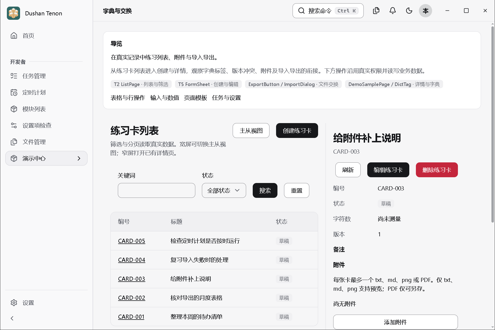
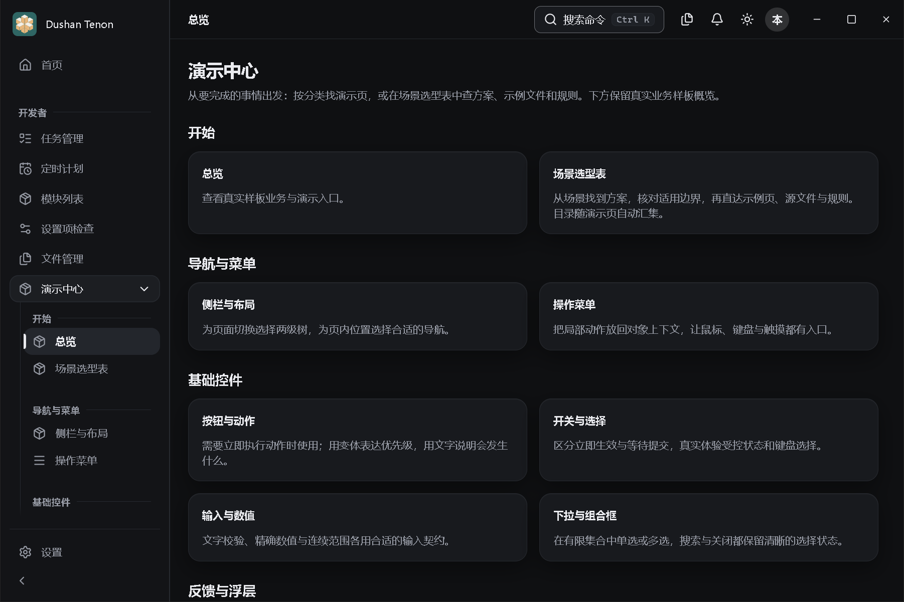
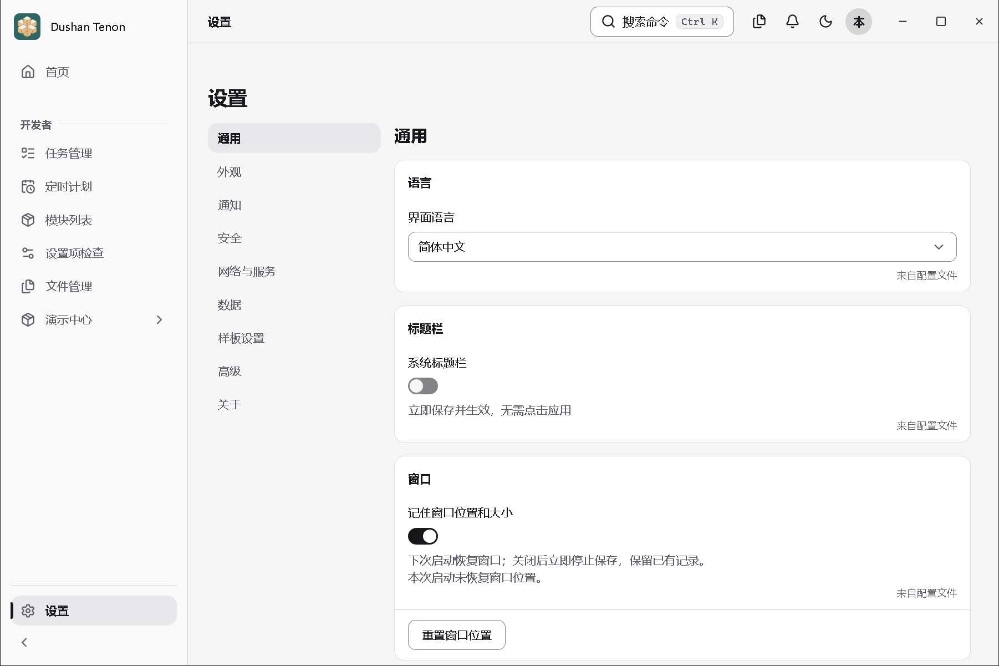

<p align="center">
  
</p>

<h1 align="center">Dushan Tenon（渡山榫卯）</h1>

<p align="center">可装配的单人桌面工具底座 · Rust + Tauri 2 + React / TypeScript</p>

<p align="center">中文 | <a href="README.en.md">English</a></p>

做一个桌面小工具，写业务本身往往花不了多少时间。真正费时间的是业务外面那一圈：登录和锁定、设置页、通知、托盘、数据存储和备份。每做一个新工具，这一圈都要再写一遍。

Dushan Tenon 把这一圈做成了底座。你可以先把它理解成一个“外围已经装好的空桌面应用”：你在上面加自己的业务模块；用不上的模块，可以在配置里关掉，也可以从代码里删掉。



*主界面（浅色）：演示中心的“字典与交换”页。5 张练习卡是在新建的状态目录里手动创建的演示数据。*

> **当前状态：**预发布（Alpha），接口和配置可能会变；只在 Windows 10 / 11 上开发和测试。

## 1. 它是什么

- 一个用 Rust + Tauri 2 + React / TypeScript 写的 Windows 桌面应用底座，用来做本机工具和独立的桌面产品。
- 面向单人使用：一台电脑上只有一个所有者。可以免登录，也可以设一个所有者账号登录，并启用应用锁。
- 按模块装配：业务功能放在模块里，由宿主显式装上。现在有 5 个模块，除了 account 都能关闭。
- 分层规则写在[架构文档](docs/architecture.md)里，并由 `pnpm check` 自动检查，代码多了以后结构也不容易乱。

## 2. 适合谁用，不适合谁

它是给开发者的底座，不是装好就能用的成品软件。

**适合：**

- 想用 Rust + Tauri + React 做 Windows 桌面工具，又不想从登录、设置、托盘写起的开发者；
- 工具只给一台电脑上的一个人用；
- 愿意按项目的分层规则写代码，并用 `pnpm check` 检查。

**不适合：**

- 想直接下载使用、不打算改代码的用户；
- 多用户、团队协作或需要服务端的系统；
- 需要在 macOS 或 Linux 上正式使用的项目。

## 3. 现在能做什么

### 五个模块

| 模块 | 做什么 | 能否关闭 |
|---|---|---|
| account | 唯一所有者，免登录或登录，会话与应用锁 | 不能，其他模块都依赖它 |
| notify | 站内通知、桌面通知、任务完成提醒 | 能 |
| files | 本机文件的列表、预览、另存副本和回收入口 | 能 |
| devtools | 后台任务的查看、取消、重试和人工处置，以及定时计划的检查 | 能 |
| demo | 样板数据、附件、导入导出、测算，以及演示中心 | 能 |

任务管理、定时计划、模块列表、设置项检查、文件管理这些排查页面和演示中心默认隐藏，在“设置 → 高级”里打开“开发者模式”后出现。



*深色模式下的演示中心总览：按分类列出组件、页面模板和业务样板的演示页。*

### 底座自带的能力

下面这些不属于哪个模块，由底座直接提供：设置中心（通用、外观、网络与服务、数据、高级、关于，模块还能加自己的分节）、命令面板（Ctrl K）、托盘和关闭窗口时的询问（隐藏到托盘或退出）、开机自启（安装版）、显示主窗口的全局快捷键、记住窗口位置和大小、单实例（再次启动时唤起已有窗口）、HTTP 代理、数据库（默认 SQLite，也能接 MySQL 或 PostgreSQL）、缓存（本地或 Redis）、后台任务和定时计划、完整备份与恢复（SQLite 加本地缓存时可用）、脱敏的诊断信息导出，以及中英文界面和浅色、深色、跟随系统三种明暗模式。



*设置页的“通用”分节。每一项右下角标出值的来源，比如“来自配置文件”。*

### 三个预设

预设是新状态目录的配置种子，决定装上哪些模块、要不要登录：

| 预设 | 启用的模块 | 登录 | 标题栏 |
|---|---|---|---|
| minimal | account | 免登录 | 系统标题栏 |
| tool | account、notify | 免登录 | 系统标题栏 |
| full | 全部五个 | 需要登录 | 应用自绘 |

三个预设都开启托盘，关闭窗口时询问隐藏到托盘还是退出，不开机自启。怎么套用见[第 4 节](#换一个预设)。

## 4. 本地跑起来

### 环境要求

- Windows 10 / 11，带 WebView2 运行时（Windows 11 自带，Windows 10 一般已通过系统更新装好）
- Microsoft C++ 生成工具（Visual Studio Build Tools 里的“使用 C++ 的桌面开发”），见 [Tauri 的前置要求](https://v2.tauri.app/start/prerequisites/)
- Node.js 24 和 pnpm 11.16.0（`package.json` 固定了这个版本）
- Rust stable 1.98 或更新版本

### 第一次启动

在仓库根目录运行：

```powershell
pnpm install
pnpm dev
```

在 PowerShell 里请用 `pnpm.cmd`，例如 `pnpm.cmd dev`。第一次运行要编译全部 Rust 依赖，会比较久。

**成功的样子：**弹出 Dushan Tenon 窗口，不需要登录，首页显示“从这里开始”。排查页面和演示中心默认隐藏，到“设置 → 高级”打开“开发者模式”就能看到。

**数据放在哪：**`pnpm dev` 固定使用仓库里的 `Temp/dev-state`，配置、数据库和日志都在里面。删掉这个目录，下次启动就是全新状态。

**出错时看哪里：**

- 提示端口 17430 被占用：关掉占用它的程序（常见的是上一次没退出的 `pnpm dev`），再运行一次；
- 窗口没出来或启动报错：看 `Temp/dev-state/logs` 里的日志。

### 换一个预设

```powershell
pnpm preset full
pnpm dev
```

`pnpm preset` 把预设写到 `Temp/dev-state/config.toml`，文件已存在时拒绝覆盖。想换预设，先删掉这个文件，或者整个 `Temp/dev-state`。full 预设需要登录，第一次启动会先请你设置所有者密码。

### 常用命令

| 命令 | 作用 |
|---|---|
| `pnpm dev` | 启动开发窗口 |
| `pnpm check` | 运行全部检查：分层与命名、产品身份、IPC 合同、UI 套件规则、发行配置、依赖许可，以及 Clippy 和 Biome |
| `pnpm test` | 运行单元测试；可以只跑一部分，例如 `pnpm test web:src/app`，用法见 `pnpm test --help` |
| `pnpm build` | 构建可执行文件，不生成安装包 |
| `pnpm bundle` | 构建 Windows 安装包，见[安装包构建与发布](docs/release.md) |
| `pnpm generate` | 改了命令清单或合同类型后，重新生成前端合同 |
| `pnpm preset` | 从 minimal、tool、full 预设创建配置 |
| `pnpm rename` | 派生时把产品名、程序名、identifier 和代号一次改成你自己的，见[派生指南](docs/derive.md) |
| `pnpm db` | 数据库工具：查看迁移状态、升级、导出 SQL，见[数据库与迁移](docs/data.md#数据库与迁移) |

## 5. 改成你自己的工具

派生成自己的工具，一般要做三件事：改产品名和代号、加自己的模块、删掉用不上的模块。[派生指南](docs/derive.md)把这三件事一步步写了出来，每一步都在本仓库里实际走过。

如果只是暂时不用某个模块，不必删代码，在 `config.toml` 里关掉它就行：

```toml
[modules.demo]
enabled = false
```

account 不能关，其他四个模块都可以单独关。

## 6. 仓库结构

```text
crates/
  framework/      内核：数据库、缓存、任务、文件、日志、IPC 执行等，不依赖 Tauri 和任何模块
  desktop/        桌面应用层：配置文件模型与设置合同，不依赖 Tauri
  module-<id>/    后端业务模块：account、notify、files、devtools、demo
src-tauri/        宿主：只做装配和 Tauri 适配，命令清单在 src/commands/list.rs
src/
  lib/            纯工具、IPC 封装、从 Rust 生成的合同
  kit/            UI 套件：组件和页面模板
  core/           前端共享设施：认证状态、i18n、设置、任务等
  shell/          外壳：布局、导航、命令面板、窗口控件
  modules/<id>/   前端业务模块
  app/            组合根：入口、路由、模块注册表、设置页装配
presets/          三个配置预设
scripts/          pnpm 命令背后的脚本
docs/             设计文档（中文）
public/           静态资源
vendor/           随仓库附带的第三方代码，许可见 THIRD_PARTY_NOTICES.md
```

前端按 lib → kit → core → shell / modules → app 单向依赖；Rust 这边只有宿主依赖 Tauri。完整规则见[架构与分层规则](docs/architecture.md)。

## 7. 接下来看什么

| 文档 | 讲什么 |
|---|---|
| [派生指南](docs/derive.md) | 改名、加模块、删模块的步骤 |
| [架构与分层规则](docs/architecture.md) | 命名、目录结构、前后端依赖方向、检查一览 |
| [模块与装配](docs/modules.md) | 五个模块、后端声明、前端清单、预设、物理裁剪一个模块 |
| [命令与 IPC](docs/ipc.md) | 唯一的命令清单、准入与权限、流与任务、错误码、生成合同 |
| [配置文件与设置](docs/settings.md) | 状态目录、配置来源与优先级、配置项、设置页分节 |
| [数据、任务与恢复](docs/data.md) | 数据库与迁移、缓存、本机文件、任务、备份与恢复、诊断包 |
| [原生能力](docs/native.md) | 窗口与关闭、单实例、自启、全局快捷键、桌面通知、HTTP 代理 |
| [前端合同与扩展](docs/frontend.md) | 分层边界、kit、core、外壳、模块页面与演示中心、组合根 |
| [安装包构建与发布](docs/release.md) | 用 `pnpm bundle` 打 Windows 安装包 |

让 AI 编码代理参与开发时，先让它读 [AGENTS.md](AGENTS.md)，那里是协作规则的摘要。

## 8. 参与和反馈

- 问题和建议请到 GitHub 提 Issue：<https://github.com/dushanaicode/dushan-tenon/issues>。Gitee 仓库是 GitHub 的只读镜像，Issue 和 PR 请都提到 GitHub。
- 报告问题时，请写上 Windows 版本和复现步骤，并附上“设置 → 关于 → 复制诊断信息”的内容。诊断信息已经脱敏，不含路径和账号。
- 贡献指南和安全问题的报告方式还在编写，写好后会放在这里。

## 许可

[MIT](LICENSE)
